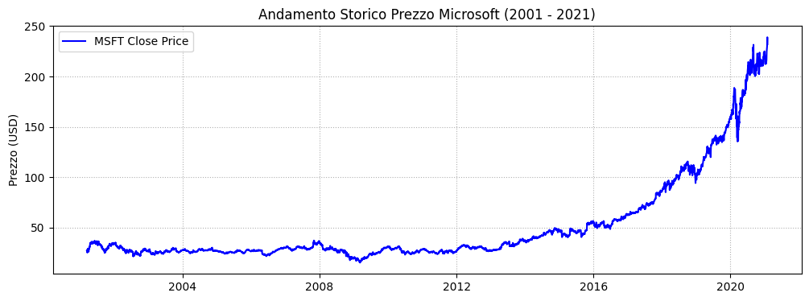
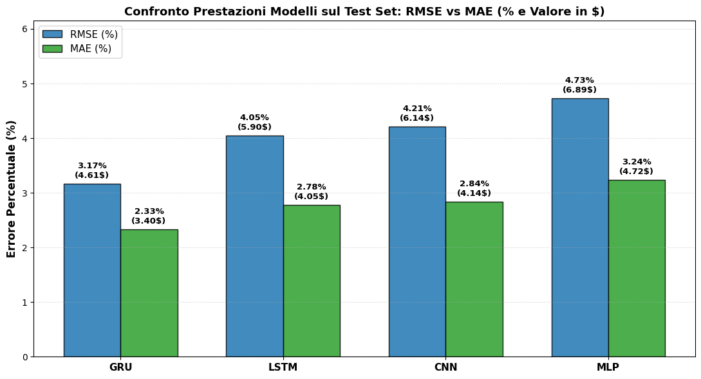
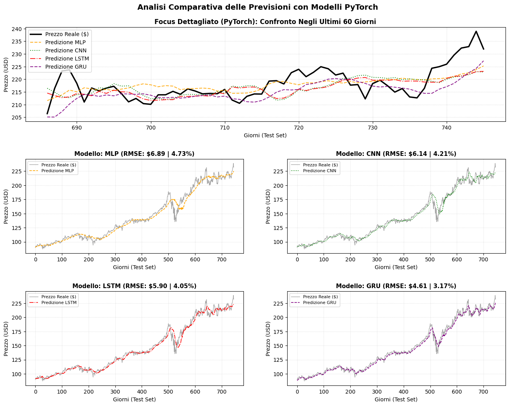

# Stock Price Forecasting with Deep Neural Networks

Course project for **Deep Neural Networks** – M.Sc. in Telecommunications Engineering, University of L'Aquila.
Author: **Diego Banfi**

## Abstract

This project compares four deep learning architectures for **one-day-ahead forecasting of the closing price of Microsoft (MSFT) stock**: a multilayer perceptron (**MLP**), a one-dimensional convolutional network (**1D-CNN**), a **LSTM** and a **GRU**.
The models are implemented in **PyTorch** and trained on 20 years of daily prices (2001–2021), using sliding windows of 29 days and a window-relative normalization that makes the problem scale-invariant.
On the test period (Feb 2018 – Jan 2021) the recurrent models perform best, and the **GRU achieves the lowest error: RMSE 3.17% and MAE 2.33%** of the average price.

## Dataset

`data/microsoft_stock.csv` – 5,000 daily records of MSFT stock, from March 2001 to January 2021 (open, high, low, close, volume). Only the closing price is used.



## Method

- **Sliding windows:** 30 consecutive days per window, the first 29 as input and the 30th as target.
- **Window-relative normalization:** each window is divided by its first price. The price grows from ~$15 to ~$239, so a global scaler fitted on the training years would put the test prices far out of range; this normalization makes the problem scale-invariant without data leakage.
- **Chronological split:** 70% training, 15% validation, 15% test.
- **Models:**

| Model | Architecture |
|---|---|
| MLP | Dense 29 → 64 → 32 → 1, ReLU, dropout 0.2 |
| 1D-CNN | Conv1D (32 filters, kernel 3) → MaxPool → Dense 32 → 1 |
| LSTM | LSTM (64 units, many-to-one) → dropout 0.2 → Dense 32 → 1 |
| GRU | GRU (64 units, many-to-one) → dropout 0.2 → Dense 32 → 1 |

- **Training:** MSE loss, Adam (lr = 1e-4), batch size 32, up to 30 epochs, early stopping with patience 10 on the validation loss, best weights restored.
- **Metrics:** MSE, RMSE and MAE in dollars and as a percentage of the average test price.

## Results

| Model | RMSE | RMSE % | MAE | MAE % |
|---|---|---|---|---|
| **GRU** | **$4.61** | **3.17%** | **$3.40** | **2.33%** |
| LSTM | $5.90 | 4.05% | $4.05 | 2.78% |
| 1D-CNN | $6.14 | 4.21% | $4.14 | 2.84% |
| MLP | $6.89 | 4.73% | $4.72 | 3.24% |





**Main findings**
- **Recurrent models (GRU, LSTM) perform best**, since they keep a memory of the previous days; the GRU gives the lowest error.
- **1D-CNN and MLP** follow fast price changes less closely, for example during the sharp drop of early 2020.
- **Window-relative normalization** was essential to predict test prices much higher than the training ones.
- **Limitation:** a naive persistence model (tomorrow's price = today's price) reaches an RMSE of 2.16% on the same test set, a well-known property of daily stock prices. Richer inputs (volume, technical indicators) or predicting returns instead of prices are natural next steps.

The full technical report is in [`docs/DNN_Stock_Prediction_report.pdf`](docs/DNN_Stock_Prediction_report.pdf).

## Repository structure

```text
.
├── dnn_stock_prediction.ipynb     # notebook with the whole pipeline (comments in Italian)
├── data/
│   └── microsoft_stock.csv
├── results/                       # plots exported from the notebook
├── docs/
│   ├── DNN_Stock_Prediction_report.pdf   # technical report
│   └── report/report.tex                 # LaTeX source of the report
├── requirements.txt
└── README.md
```

## How to run

**Locally (Jupyter):**
```bash
git clone https://github.com/Diegobanfi/dnn-stock-prediction.git
cd dnn-stock-prediction
pip install -r requirements.txt
jupyter notebook dnn_stock_prediction.ipynb
```

**On Google Colab:** open the notebook in Colab and run all cells; the first cell clones the repository automatically to get the dataset. A GPU is optional: the whole notebook also runs on CPU in a few minutes.

Random seeds are fixed (`set_seed(42)`); small differences in the results are possible between CPU and GPU.

## Tools

Python · PyTorch · NumPy · Pandas · scikit-learn · Matplotlib · Deep learning · Time-series forecasting
